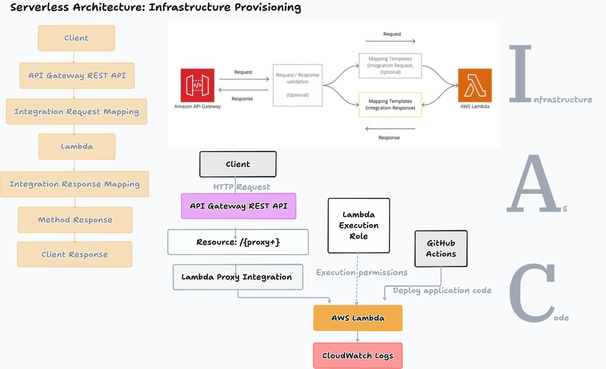

# AWS Infrastructure Automation: Terraform and Terraform Cloud State

This directory contains a Terraform configuration for AWS connected to Terraform Cloud (now called **HCP Terraform**) for state management.

## Serverless Infra Provisioning Architectural Design (Lambda + API Gateway - Rest API)


## Current configuration

| Setting | Value in `main.tf` |
| --- | --- |
| Terraform CLI | Exactly `1.17.1` |
| AWS provider | `hashicorp/aws`, exactly `6.72.0` |
| AWS region | `ap-southeast-1` (Singapore) |
| HCP Terraform organization | `JoyShaha` |
| HCP Terraform workspace | `serveless_automation` |

Files in this directory:

- `main.tf`: Terraform requirements, cloud connection, AWS provider, and commented resource examples.
- `.terraform.lock.hcl`: Provider version and checksum lock file; keep this in version control.
- `.terraform/`: Generated initialization metadata and downloaded providers; do not commit it.

**No AWS resources are currently enabled.** The S3 bucket, VPC, internet gateway, gateway attachment, and subnet examples are commented out. There is no `aws_instance` resource, input variable, or output defined yet. Before enabling the gateway attachment example, also enable its referenced VPC and gateway.

If the connected workspace already manages resources, applying this configuration with all resources commented out can propose deleting those resources. Always inspect the plan.

## How Terraform state works

Terraform uses state to associate configuration resource addresses with real AWS objects. A plan compares configuration, recorded state, and the current infrastructure to determine changes.

This configuration uses a `cloud` block:

```hcl
terraform {
  cloud {
    organization = "JoyShaha"

    workspaces {
      name = "serveless_automation"
    }
  }
}
```

This is an excerpt of the existing block, not an additional block to paste into `main.tf`. Do not add an S3 or other `backend` block alongside it. HCP Terraform stores the workspace's state remotely, maintains state versions, and coordinates locking. An S3 bucket and DynamoDB table are not required for this setup.

The generated `.terraform/terraform.tfstate` file is connection metadata, not the authoritative infrastructure state. See HashiCorp's [cloud connection guide](https://developer.hashicorp.com/terraform/cli/cloud/settings) and [workspace state documentation](https://developer.hashicorp.com/terraform/cloud-docs/workspaces/state).

## Choose where Terraform runs

State storage and execution location are separate choices. In the HCP Terraform workspace, open **Settings → General → Execution Mode**:

| Mode | Where plan/apply runs | Where AWS credentials belong | State location |
| --- | --- | --- | --- |
| Local | Your terminal, dev container, or CI runner | In that execution environment | HCP Terraform |
| Remote | HCP Terraform runner | Workspace environment variables or configured dynamic credentials | HCP Terraform |

Choose **Local** if you only want Terraform Cloud to manage state. Choose **Remote** to run plans and applies in the cloud as well. The execution mode is a workspace setting; it cannot be determined from this directory alone. See [workspace settings](https://developer.hashicorp.com/terraform/cloud-docs/workspaces/settings).

## Setup

1. Install Terraform `1.17.1`. Check with `terraform version`. For remote execution, configure the workspace to use the same version.
2. Sign in to [HCP Terraform](https://app.terraform.io), confirm access to the `JoyShaha` organization, and create or select the `serverless_automation` workspace using the CLI-driven workflow. If using your own account, update the organization and workspace values in `main.tf`.
3. Select an execution mode and configure AWS authentication:
   - **Local:** Use your AWS profile, environment credentials, or an IAM role available to the terminal/container. If the AWS CLI is available, check the identity with `aws sts get-caller-identity`.
   - **Remote:** Configure AWS dynamic credentials, or set `AWS_ACCESS_KEY_ID` and `AWS_SECRET_ACCESS_KEY` as workspace **environment variables**. Temporary credentials also require `AWS_SESSION_TOKEN`. Mark credential values sensitive. Local AWS profiles are not available to remote runners.
4. From the repository root, authenticate and initialize:

```bash
cd terraform/env/dev
terraform login
terraform init
terraform validate
```

If using the supplied dev container, the directory is `/workspace/terraform/env/dev`. Run authentication inside the container; host credentials are not automatically available there.

`terraform login` authenticates to HCP Terraform, not AWS. Never put either service's credentials into `main.tf` or commit them.

## Normal workflow

Run these commands inside `terraform/` after initialization:

```bash
terraform fmt # terraform fmt --recursive
terraform validate
terraform plan
cd /env/dev # development infra provisioning
```

Review the proposed changes and confirm the workspace and AWS account before applying:

```bash
terraform apply
```

`terraform apply` produces a plan and asks for approval. In Remote mode, follow the run URL printed by Terraform to inspect the cloud run. See the [CLI-driven workflow](https://developer.hashicorp.com/terraform/cloud-docs/workspaces/run/cli).

### Makefile can be used for deployment 
```bash
cd terraform/
make <option_name>
```

## Migrate existing local state

Skip this section if the correct state is already in the intended HCP Terraform workspace. The cloud block alone does not prove that a migration has occurred.

1. Stop other Terraform runs and securely back up the existing local `terraform.tfstate` and any workspace state files. For a previously initialized backend, `terraform state pull` can export its state; capture it securely **before** changing the connection.
2. Confirm the destination organization/workspace and check that it does not contain unrelated state.
3. Add the cloud block (already present here), removing any previous `backend` block.
4. Run `terraform login`, then `terraform init`, and review the migration prompts. For migration into a `cloud` block, use the interactive initialization flow rather than `terraform init -migrate-state`.
5. Verify the state in the workspace's **States** page and run `terraform state list`. Run `terraform plan` and investigate unexpected creates or destroys before applying.

Keep the backup until verification is complete. Do not delete state to resolve initialization errors. Follow the [official migration steps](https://developer.hashicorp.com/terraform/cli/cloud/settings#migrate-state-data).

## Inspect and protect state

```bash
# List resource addresses recorded in the connected workspace.
terraform state list

# Inspect one address returned by the previous command.
terraform state show '<resource-address>'
```

An empty resource list can be expected for a new workspace with this configuration. State and plan files can contain secrets; avoid sharing their contents or storing them in Git. Limit workspace access and coordinate with teammates before any recovery or manual state operation. Do not force-unlock an active run.

Suggested Git ignore rules for this directory (add them to your `.gitignore`):

```gitignore
.terraform/
*.tfstate
*.tfstate.*
*.tfplan
crash.log
crash.*.log
*.tfvars
*.tfvars.json
```

Keep `.terraform.lock.hcl` tracked. Store backups and credentials outside the configuration directory, which can be uploaded during remote runs.

## Troubleshooting

| Symptom | Check |
| --- | --- |
| Unsupported Terraform version | Install exactly `1.15.7`; check the remote workspace version too. |
| Organization/workspace access denied | Run `terraform login` and confirm organization membership and workspace permissions. |
| No valid AWS credentials | Configure credentials where execution happens: local environment or cloud workspace. |
| State is locked | Check for an active run and let it finish; investigate abandoned runs before unlocking. |
| Provider cannot execute | The existing cache includes a Linux ARM64 provider. Run `terraform init` in the actual host/container environment to install the appropriate binary. |
| No resources to create | Resource examples are commented out; add or enable the intended resources first. |
| Unexpected deletion plan | Check whether resources in remote state are missing from the active configuration. Do not approve until reconciled. |