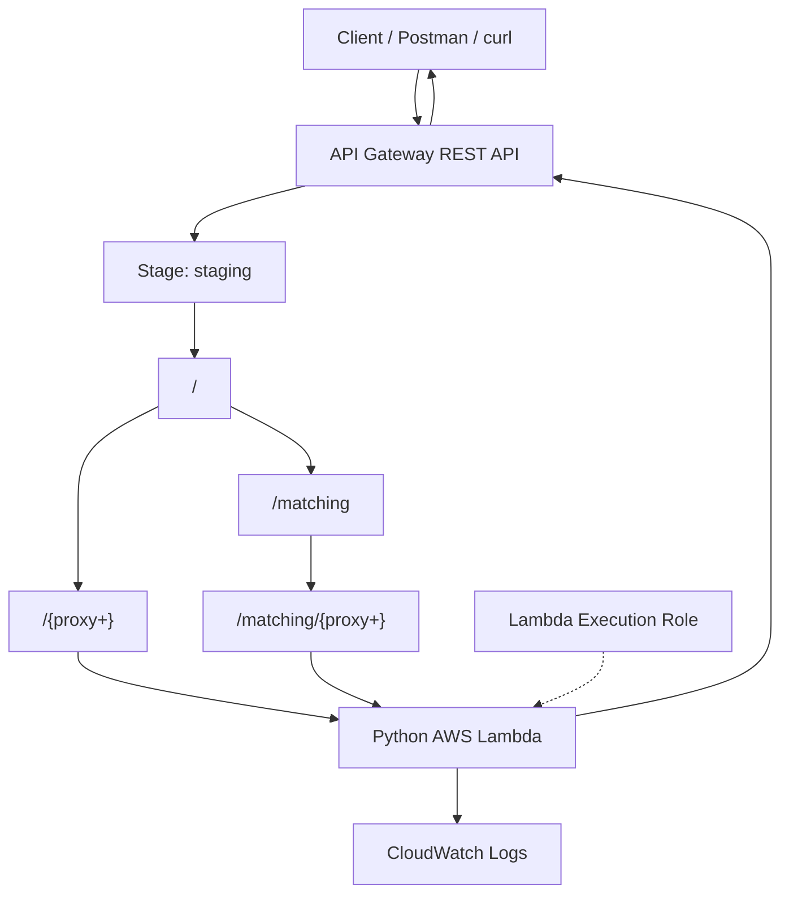

# AWS Lambda + API Gateway REST API with Terraform

A modular Infrastructure as Code (IaC) project to provision AWS Lambda and API Gateway REST API using Terraform.

This project demonstrates a serverless REST API where API Gateway receives HTTP requests, forwards request payloads to a Python Lambda function, and returns the Lambda response to the client.

## Architecture



### Request flow

1. Client sends an HTTP request with a JSON payload.
2. API Gateway receives the request and matches the resource.
3. Lambda proxy integration forwards the request to Python Lambda.
4. Lambda processes the payload.
5. Lambda returns a status code, headers, and response body.
6. API Gateway returns the response to the client.

## Features

- Python AWS Lambda function.
- Custom Lambda execution IAM role.
- CloudWatch Logs permissions.
- API Gateway REST API.
- Root greedy proxy resource: `/{proxy+}`.
- Nested greedy proxy resource: `/matching/{proxy+}`.
- Shared Lambda integration for both proxy resources.
- `ANY` HTTP method support.
- Lambda proxy integration (`AWS_PROXY`).
- API Gateway deployment and `staging` stage.
- Modular Terraform architecture.

## Technology Stack

| Technology | Purpose |
|---|---|
| Terraform | Infrastructure provisioning |
| AWS Lambda | Serverless application execution |
| Python | Lambda application |
| API Gateway REST API | HTTP routing and API management |
| AWS IAM | Lambda execution permissions |
| Amazon CloudWatch | Application logging |
| AWS CLI | AWS authentication and management |

## Project Structure

```text
terraform/
├── blueprint/
│   ├── main.tf
│   ├── variables.tf
│   └── outputs.tf
├── app.py
├── lambda.zip
├── makefile
├── modules/
│   ├── lambda/
│   │   ├── main.tf
│   │   ├── variables.tf
│   │   └── outputs.tf
│   └── api_gateway/
│       ├── main.tf
│       ├── variables.tf
│       └── outputs.tf
└── README.md
```

### Module responsibilities

**Lambda module**
- Creates the Lambda execution IAM role and trust policy.
- Adds CloudWatch logging permissions.
- Provisions the Python Lambda function.
- Configures environment variables, timeout, and memory.

**API Gateway module**
- Creates the REST API.
- Creates root and nested proxy resources.
- Configures `ANY` methods and Lambda proxy integrations.
- Grants API Gateway permission to invoke Lambda.
- Creates API deployment and stage.

## API Gateway Resource Structure

```text
staging
└── /
    ├── /{proxy+}
    └── /matching
        └── /{proxy+}
```

### Root proxy

Resource: `/{proxy+}`

Examples:
- `/users`
- `/users/123`
- `/admin/login`
- `/appointment`
- `/auth`
- `/report`

### Nested proxy

Resource: `/matching/{proxy+}`

Examples:
- `/matching/users`
- `/matching/users/123`
- `/matching/appointments`
- `/matching/appointments/search`

Both proxy resources invoke the same Lambda function.

> A greedy proxy does not match its parent path itself. If `/matching` should invoke Lambda, add an `ANY` method and Lambda integration directly to the `/matching` resource.

## Prerequisites

Install:
- Terraform
- AWS CLI
- Python
- ZIP utility

Configure AWS credentials:

```bash
aws configure
```

Verify AWS authentication:

```bash
aws sts get-caller-identity
```

Verify Terraform:

```bash
terraform version
```

Verify Python:

```bash
python3 --version
```

## Lambda Application

Example `app.py`:

```python
import json


def lambda_handler(event, context):
    http_method = event.get("httpMethod")
    path = event.get("path")

    path_parameters = event.get("pathParameters") or {}
    proxy_path = path_parameters.get("proxy")

    body = event.get("body")
    payload = json.loads(body) if body else {}

    response = {
        "message": "Lambda executed successfully",
        "method": http_method,
        "path": path,
        "proxy_path": proxy_path,
        "payload": payload,
    }

    return {
        "statusCode": 200,
        "headers": {
            "Content-Type": "application/json",
            "X-Application": "Python-Lambda",
        },
        "body": json.dumps(response),
    }
```

The Lambda event includes the HTTP method, path, path parameters, query string parameters, headers, body, and API Gateway request context.

## Build Lambda Deployment Package

From the project root:

```bash
zip lambda.zip app.py
```

The package contains:

```text
lambda.zip
└── app.py
```

If the application uses third-party dependencies, package them with the function or use a Lambda layer.

## Terraform Configuration

The root module connects the Lambda and API Gateway modules.

Example:

```hcl
module "lambda" {
  source = "./modules/lambda"

  function_name = "dev-python-api"
  runtime      = "python3.14"
  handler      = "app.lambda_handler"
  filename     = "${path.module}/lambda.zip"

  timeout     = 30
  memory_size = 256

  environment_variables = {
    ENVIRONMENT = "dev"
    LOG_LEVEL   = "INFO"
  }
}

module "api_gateway" {
  source = "./modules/api_gateway"

  api_name   = "dev-python-rest-api"
  stage_name = "staging"

  lambda_invoke_arn    = module.lambda.lambda_invoke_arn
  lambda_function_name = module.lambda.lambda_function_name
  lambda_function_arn  = module.lambda.lambda_function_arn
}
```

> Confirm that the selected Python runtime is supported by AWS Lambda in your target region before deployment.

## Deploy Infrastructure

Initialize Terraform:

```bash
terraform init
```

Validate configuration:

```bash
terraform validate
```

Review the plan:

```bash
terraform plan
```

Provision infrastructure:

```bash
terraform apply
```

Review outputs:

```bash
terraform output
```

## Get API Gateway URL

```bash
terraform output -raw api_gateway_url
```

Example URL:

```text
https://<api-id>.execute-api.<region>.amazonaws.com/staging
```

AWS generates the API ID and URL.

## API Testing

Replace `<api-id>` and `<region>` with the values from your deployment.

### Root proxy

Endpoint:

```text
POST /staging/users
```

Request:

```bash
curl -X POST \
  "https://<api-id>.execute-api.<region>.amazonaws.com/staging/users" \
  -H "Content-Type: application/json" \
  -d '{
    "name": "Joy",
    "role": "Software Engineer",
    "skills": ["Python", "AWS", "Terraform"]
  }'
```

### Nested proxy

Endpoint:

```text
POST /staging/matching/users
```

Request:

```bash
curl -X POST \
  "https://<api-id>.execute-api.<region>.amazonaws.com/staging/matching/users" \
  -H "Content-Type: application/json" \
  -d '{
    "name": "Joy",
    "role": "Software Engineer",
    "skills": ["Python", "AWS", "Terraform"]
  }'
```

### Expected response

```json
{
  "message": "Lambda executed successfully",
  "method": "POST",
  "path": "/matching/users",
  "proxy_path": "users",
  "payload": {
    "name": "Joy",
    "role": "Software Engineer",
    "skills": ["Python", "AWS", "Terraform"]
  }
}
```

## Lambda Proxy Integration

This project uses:

```hcl
type = "AWS_PROXY"
```

Lambda proxy integration forwards the HTTP request to Lambda and returns the Lambda response.

Lambda controls:
- HTTP status code.
- Response headers.
- Response body.

Example:

```python
return {
    "statusCode": 200,
    "headers": {
        "Content-Type": "application/json",
        "X-Application": "Python-Lambda",
    },
    "body": json.dumps({"message": "Success"}),
}
```

For proxy integration, separate API Gateway integration response mapping resources are not required for the Lambda response.

### Non-proxy integration

If API Gateway must transform request or response data, use a non-proxy integration:

```hcl
type = "AWS"
```

Non-proxy integration supports API Gateway-managed:
- Integration request mapping.
- Integration response mapping.
- Method response configuration.
- Response header mapping.
- Request and response templates.

This requires additional configuration and is not interchangeable with the proxy integration.

## IAM Permissions

The Lambda execution role allows:

```text
logs:CreateLogGroup
logs:CreateLogStream
logs:PutLogEvents
```

The IAM trust policy allows Lambda to assume its execution role.

API Gateway receives permission to invoke Lambda through:

```text
lambda:InvokeFunction
```

The Lambda execution role and API Gateway invocation permission are separate permissions.

## Terraform Outputs

| Output | Description |
|---|---|
| `lambda_function_name` | Lambda function name |
| `lambda_function_arn` | Lambda ARN |
| `lambda_execution_role_arn` | Lambda execution role ARN |
| `api_gateway_url` | API Gateway stage URL |
| `api_gateway_id` | REST API ID |

Retrieve the API URL:

```bash
terraform output api_gateway_url
```

## Destroy Infrastructure

To remove the provisioned infrastructure:

```bash
terraform destroy
```

Review the Terraform plan before confirming destruction.

## Security Considerations

- Never commit AWS access keys or secret credentials.
- Use least-privilege IAM permissions.
- Configure API Gateway authorization for production.
- Configure throttling and quotas.
- Validate request payloads.
- Avoid logging sensitive request data.
- Store secrets in AWS Secrets Manager or an appropriate secret store.
- Use encrypted remote Terraform state with access controls for shared environments.

## Future Improvements

- API Gateway authentication and authorization.
- Request validation.
- API Gateway request and response mapping.
- Custom domain and TLS configuration.
- CloudWatch monitoring and alarms.
- Lambda versions and aliases.
- Terraform remote state.
- Separate development, staging, and production environments.
- GitHub Actions CI/CD.

## License

This project is intended for learning, experimentation, and infrastructure development.

Add a license file if you plan to distribute or reuse the project publicly.
